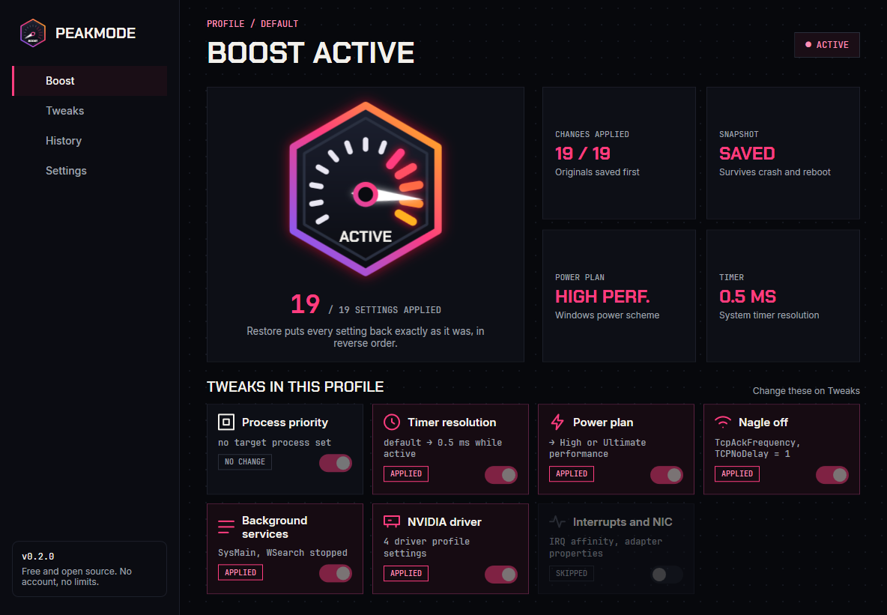
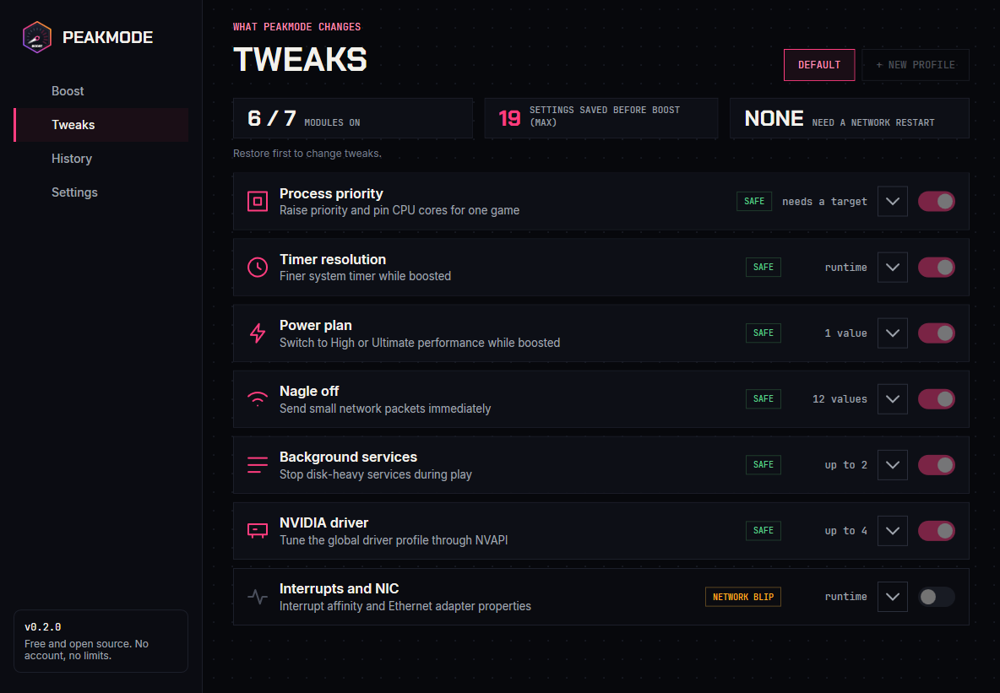
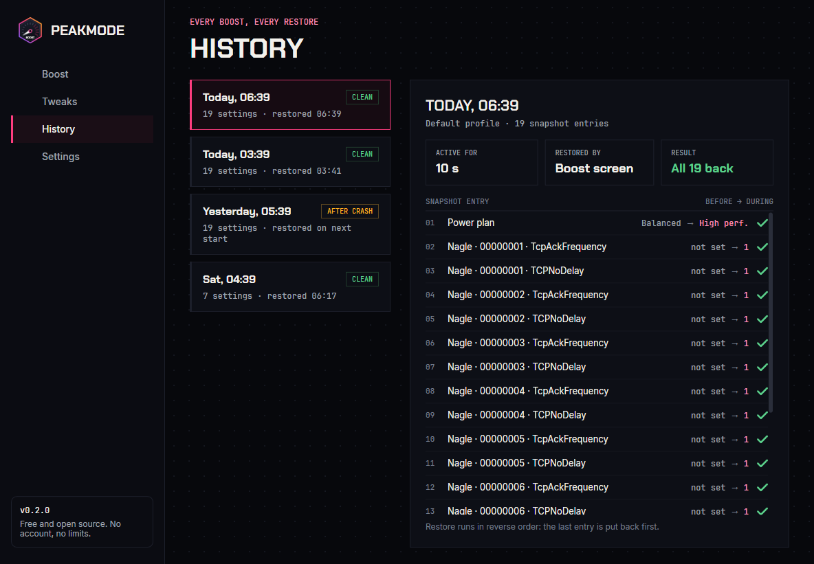

<p align="center">
  
</p>

# PeakMode

A Windows tray app that applies a set of gaming performance tweaks with one click and undoes every one of them with the next click.

Every change is recorded on disk before it is made, so PeakMode can put your system back even after a crash, a killed process or a reboot.

<p align="center">
  
</p>

---

## What it does

**Windows**
- Raises the priority of your game process to High (`windows.targetProcess`)
- Pins the game to one thread per physical core (P-cores only on hybrid Intel CPUs)
- Opt-in, off by default: requests 0.5 ms timer resolution while PeakMode runs. On Windows 10 2004 and later the request only affects PeakMode's own process; games set their own timer ([#9](https://github.com/SoloScriptSage/PeakMode/issues/9))
- Switches to the High Performance or Ultimate Performance power plan
- Disables Nagle's algorithm (`TcpAckFrequency=1`, `TCPNoDelay=1`) on all network interfaces
- Stops SysMain (Superfetch) and Windows Search while active

**NVIDIA** (global driver profile, via NVAPI)
- Power management: prefer maximum performance
- Max pre-rendered frames: 1 (the driver's "Low Latency Mode: On")
- Vertical sync: force off
- Threaded optimization: on

**Network adapter interrupts** (off by default, see below)
- Routes the Ethernet adapter's interrupts away from CPU core 0
- Turns off interrupt moderation, Energy Efficient Ethernet, power saving and Wake-on-LAN on the adapter

**Which tweaks, and why not others.** [docs/tweak-verdicts.md](docs/tweak-verdicts.md) checks the tweaks that popular "Windows tweaks for gaming" videos recommend against Microsoft, NVIDIA and AMD documentation, with a source for every verdict. It also lists what that check found about PeakMode itself: the timer resolution request does not reach the game on Windows 10 2004 and later (measured in [#9](https://github.com/SoloScriptSage/PeakMode/issues/9), so it is now opt-in), and the power plan and SysMain tweaks still need a before/after measurement.

### Why interrupt tweaks are off by default

Adapter settings only take effect after the adapter restarts, so with `interruptTweaks` enabled PeakMode **disables and re-enables your Ethernet adapter on activate and again on restore**. Your connection drops for a few seconds each time, and anything online (a game lobby, a call, a download) may disconnect. Turn it on only if that is acceptable. Wi-Fi adapters are never touched.

---

## The main window

New in 0.2.0. Open it from the tray menu (**Open PeakMode**). Closing the window hides it; the tray keeps running. Screens: Boost, Tweaks, Checkup (0.3.0), History and Settings.

- **Boost.** The logo is the button: a tachometer whose needle moves as the core applies each step, then revs at the redline while active. Four cards show the changes applied, the snapshot state, the active power plan and the global timer resolution (information only: games set their own timer, [#9](https://github.com/SoloScriptSage/PeakMode/issues/9)). Below, one card per tweak shows READY, APPLYING, APPLIED, SKIPPED or RESTORED. Clicking the gauge again restores everything, newest change first. With Windows "Show animations" off, the gauge jumps between states.
- **Tweaks.** Every module with a one-line description, a risk tag (SAFE or NETWORK BLIP), how many values it saves, and a switch that writes to `config\peakmode.json`. Expand a row to see exactly what changes, how it is restored and what it needs. The target process is set here too. Switches are locked while a boost is active.
- **Checkup.** New in 0.3.0, read-only: six checks of things outside a boost that often cost more than any tweak. Display refresh rate below the monitor's highest, memory slower than its rated speed, battery or power mode, GPU driver age and which GPU the last boosted game ran on, Memory Integrity (information only), and temperatures (GPU, and the ACPI thermal zone, labeled as not the CPU core temperature). Each row is OK, WORTH CHECKING or INFO with a one-line fix you make yourself; PeakMode changes none of it. What each check reads and can't tell: [docs/checkup.md](docs/checkup.md).
- **History.** Every boost and restore from the session log: when, how many settings, how it ended (CLEAN, AFTER CRASH, PARTIAL), how long it was active and what restored it. The selected session lists its snapshot entries with the value before and during the boost. If PeakMode was still active when it last closed, a banner offers RESTORE NOW.

<p align="center">
  
  
</p>

The screenshots come from the preview build on a simulated core (see Building), so the sessions and interface ids in them are sample data.

---

## Install and use

1. Download `PeakMode-<version>-win-x64.zip` from the [releases](../../releases) and extract it anywhere.
2. Optionally set your game's exe name on the Tweaks screen, or edit `config\peakmode.json` directly (`windows.targetProcess`).
3. Run `PeakModeTray.exe` and accept the administrator prompt. The icon appears in the tray (grey = idle).
   The exe is not code-signed, so on first start Windows SmartScreen may show "Windows protected your PC". Click **More info**, then **Run anyway**.
4. Left-click the tray icon to activate (icon turns colored), left-click again to restore. Or open the window and click the gauge. Right-click the icon for the menu: open PeakMode, open config, open log, exit.

The release is self-contained: no .NET runtime needs to be installed. Exiting the tray while active restores everything first.

### Requirements

- Windows 10 or 11, 64-bit (tested on Windows 11 23H2 only)
- Administrator rights (services, power plan, registry and driver settings)
- NVIDIA GPU and driver for the NVIDIA tweaks (skipped automatically otherwise)

---

## Safety and recovery

- **Write-ahead snapshot.** Before each individual change, PeakMode writes the original value to `C:\ProgramData\PeakMode\snapshot.json`. If another program briefly has the file open, the write is retried for about half a second. If the write still fails, the change is not made. Values that did not exist before are recorded as such and deleted again on restore.
- **Restore works from a fresh process.** Restore uses only the snapshot file, in reverse order. The file is deleted only when every item was restored; failed items stay in it so you can retry.
- **Crash or reboot while active.** On the next start the tray asks whether to restore the original settings, and the History screen shows a restore banner. Until then the tray shows "restore pending".
- **Logoff and shutdown.** The tray restores on session end. If Windows ends it first, you get the restore prompt on the next start.
- **Locked-down state folder.** `C:\ProgramData\PeakMode` is accessible to Administrators and SYSTEM only. PeakMode repairs that ACL on startup, refuses a folder or snapshot file not owned by Administrators/SYSTEM, and only restores registry values under the three keys it changes.
- **Session log.** `C:\ProgramData\PeakMode\sessions.jsonl` records each session's start, its snapshot entries and how it ended (what restored it, ok or partial, how many items). It is append-only, in the same locked-down folder, and moves to `sessions.1.jsonl` at 1 MB. Writing it never blocks activate or restore.
- **Log.** `C:\ProgramData\PeakMode\peakmode.log` (also reachable from the tray menu).

If something is ever left tweaked, see [RECOVERY.md](scripts/RECOVERY.md) (also included in the release zip).

---

## Configuration

`config\peakmode.json` next to `PeakModeTray.exe`. The Tweaks screen edits the same file and keeps every other key and the key order (comments are not kept). Missing keys use the defaults below; unknown keys are logged and ignored; a malformed file stops activation with an error instead of falling back silently.

| Key | Default | Effect |
|---|---|---|
| `windowsTweaks` | `true` | Enable the Windows section |
| `nvidiaTweaks` | `true` | Enable the NVIDIA section |
| `interruptTweaks` | `false` | Enable the network adapter section (restarts the adapter) |
| `windows.targetProcess` | `""` | Game exe name, e.g. `"cs2.exe"`. Must be running when you activate. Empty skips priority and affinity |
| `windows.setProcPriorityHigh` | `true` | High priority for the target process |
| `windows.pinToPCores` | `true` | Target process affinity: one thread per physical core |
| `windows.setUltimatePerf` | `true` | High/Ultimate Performance power plan |
| `windows.disableNagle` | `true` | Nagle off on all interfaces (new connections) |
| `windows.disableSysMain` | `true` | Stop SysMain while active |
| `windows.disableSearchIndex` | `true` | Stop Windows Search while active |
| `windows.setTimerResolution` | `false` | Opt-in: 0.5 ms timer resolution while PeakMode runs. Lowers the global value but does not reach the game on Windows 10 2004 and later ([#9](https://github.com/SoloScriptSage/PeakMode/issues/9)) |
| `nvidia.maxPerfMode` | `true` | Prefer maximum performance |
| `nvidia.disableVSync` | `true` | Force VSync off |
| `nvidia.disablePrerenderFrames` | `true` | Max pre-rendered frames = 1 |
| `nvidia.threadedOptimization` | `true` | Threaded optimization on |
| `interrupt.nicInstanceId` | `""` | Adapter PnP instance id. Empty = first connected physical Ethernet adapter |
| `interrupt.redirectNicIrq` | `true` | Interrupts on all physical cores except core 0 |
| `interrupt.disableNicInterruptMod` | `true` | Adapter properties listed above; only values the driver declares valid |

---

## Architecture

```
PeakModeTray.exe  (C# WPF tray app and main window, .NET 8, self-contained)
  TrayApp          tray icon and menu, restore prompt, restore on logoff
  MainWindow       Boost, Tweaks, Checkup, History and Settings screens
                   (view models in ViewModels/)
  ProfileStore     reads and writes config\peakmode.json for the Tweaks screen
  Checkup/         read-only system readers (P/Invoke: display modes, SMBIOS,
                   power, D3DKMT, SetupAPI, code integrity, PDH), the check
                   rules, and the GPU sample taken during a boost
  CoreService      the only caller of the DLL: runs activate/restore one at a
                   time on a worker thread, raises progress and state events
                   on the UI thread, passes the restore reason
        |
        |  P/Invoke (C ABI, UTF-8 strings, int status codes, progress callback)
        v
PeakModeCore.dll  (C++20)
  Orchestrator     activate / restore in steps, progress events per step and
                   per restored entry, status and error reporting
  ProfileManager   loads config\peakmode.json (nlohmann/json)
  Snapshot         write-ahead journal in C:\ProgramData\PeakMode, entries
                   tagged with the step that recorded them
  SessionLog       append-only sessions.jsonl: begin, active (entries), end
                   (reason, result, restored, failed), gpu (the GPU the
                   boosted game used, for the Checkup)
  Registry         journaled HKLM writes, restricted to known keys
  Modules
    WindowsTweaks    priority, affinity, timer, power plan, Nagle, services
    NvidiaTweaks     NVAPI driver settings (DRS)
    InterruptTweaks  adapter IRQ policy and advanced properties
```

Progress events: activate sends a begin and an end event for each step (process, timer, power, Nagle, services, NVIDIA, interrupts) with its status and the running entry count; restore sends one event per restored entry, in restore order. The Boost gauge and the tweak cards move on these events, not on a timer.

Restore reasons stored in the session log: tray, window, exit, sessionEnd, crashPrompt, banner, cli, rollback.

`peakmode_test.exe` is a command line front end to the same DLL, used for testing and manual recovery: `activate`, `restore`, `status`, `dump`, `selftest`.

---

## Building

Requirements: Visual Studio 2022 with the C++ desktop workload and CMake, .NET 8 SDK.

```powershell
cmake -S core -B core/build -A x64
cmake --build core/build --config Release
core/build/Release/peakmode_test.exe selftest config/peakmode.json

# UI tests (no core, no system changes)
dotnet test ui/PeakModeTray.Tests -c Release

# Release zip in dist\ (same script CI uses)
./scripts/package.ps1 -Version 0.2.1 -CoreDll core/build/Release/PeakModeCore.dll
```

A Debug build of the tray has a preview mode for UI work: `PeakModeTray.exe --window-preview` opens the main window on a simulated core with sample history and changes nothing on the system (it edits a copy of the config in `%TEMP%`). Add `--preview-pending` to start with a leftover session and the restore banner.

See [CONTRIBUTING.md](CONTRIBUTING.md) for the rules a tweak must meet and how on-machine cycles are run.

CI (`.github/workflows/build.yml`) builds, runs the core self-test and the UI tests, and packages on every push to `main` and every pull request; tags `v*` publish the zip as a GitHub release.

The NVAPI headers and import library in `core/third_party/nvapi` are a vendored subset of the NVIDIA NVAPI SDK (MIT). The bundled fonts (Chakra Petch, Inter, JetBrains Mono) are under the SIL Open Font License; their licenses ship in the release zip.

---

## Test status

All on-machine tests ran on one PC: Windows 11 Pro 23H2 (22631), AMD Ryzen 7 4800H, NVIDIA RTX 3050 Ti Laptop GPU, Realtek RTL8168 Ethernet. Each cycle captures every setting PeakMode touches before activating, while active, and after restore (`scripts/verify-state.ps1`), and passes only if the state after restore is identical to before. In the v0.1.0 cycles the restore ran in a separate, fresh process, the same path used after a crash.

| Area | Applied and verified | Restored to identical state | Notes |
|---|---|---|---|
| Target process priority | Yes | Yes | Tested with Notepad as the target |
| Target process affinity | Yes | Yes | `0xFFFF` to `0x5555` on 8 cores / 16 threads |
| Timer resolution (opt-in since 0.3.0) | Yes (0.5 ms global while active) | Yes (released) | Measured in the tray cycle. Does not reach other processes ([#9](https://github.com/SoloScriptSage/PeakMode/issues/9)), so it is off by default |
| Power plan | Yes (High Performance) | Yes | Creating a temporary plan copy (fallback path): **untested** |
| Nagle | Yes | Yes | 6 interfaces |
| SysMain / Windows Search | Yes | Yes | Services already stopped before activation: **untested** |
| NVIDIA driver settings | Yes | Yes | Settings at driver default before activation: **untested** |
| Adapter IRQ policy | Yes (registry) | Yes | Actual interrupt routing not measured |
| Adapter properties | Yes | Yes | Buffer sizes skipped: this driver's maximum is already set; applying them: **untested** |
| Adapter restart | Yes | Yes | |
| Everything at once (default config with interrupt tweaks on) | Yes | Yes | 28 snapshot entries |
| Crash during activation | | Yes | Killed after entry 15, 21 and 28 |
| Crash while the adapter is disabled | | **Untested** | Covered by the same restore path, not reproduced |
| Tray: toggle, kill + restore prompt, exit while active | Yes | Yes | |
| Tray icon colors and notifications | **Untested** | | Not visually confirmed yet |
| Reboot with a pending snapshot, restore prompt after login | | Yes | |
| Restart with the tray active (restore on shutdown) | | **Untested** | |
| State folder ACL | Yes (self-test) | | Also repaired on the test machine |
| Intel hybrid CPUs (P-core detection) | **Untested** | | |
| PCs without an NVIDIA GPU | **Untested** | | Module is skipped when NVAPI is unavailable |
| Windows 10 | **Untested** | | |
| GitHub Actions build, self-test and packaging | Yes | | [Run 45060641184](https://github.com/SoloScriptSage/PeakMode/actions/runs/45060641184) on windows-latest, including the state folder ACL self-test |
| GitHub Actions release on a `v*` tag | Yes | | [Run 45062573365](https://github.com/SoloScriptSage/PeakMode/actions/runs/45062573365) published the v0.1.0 release |
| v0.1.0 release zip as downloaded: tray Activate and Restore | Yes | Yes | Default config, 19 snapshot entries; state after restore identical to before |
| 0.2.0: activate from the window, restore from the tray | Yes | Yes | 17 snapshot entries; one Nagle interface skipped because the snapshot write failed ([#5](https://github.com/SoloScriptSage/PeakMode/issues/5)); session log `reason=tray` |
| 0.2.0: activate and restore both with the Boost gauge | Yes | Yes | Default config, 19 snapshot entries; all 41 captured values identical after restore; session log `reason=window`, `ok`, 19 restored, 0 failed |
| 0.2.0: History screen on the real session log | Yes | | Showed that cycle as CLEAN, restored by Boost screen, all 19 entries with before and during values; older sessions including one AFTER CRASH |
| 0.2.0: FPS effect in Dota 2 (CapFrameX, 5 × 60 s runs) | | | No measurable difference: run-to-run spread (~10 FPS) is larger than any on/off difference; CPU already at max boost, GPU ~40% (CPU-bound). [Measurement](docs/measurements/2026-11-24-dota2-laptop.md) |
| 0.2.0: History restore banner on a real leftover snapshot | **Untested** | | Tested in the preview only |
| 0.2.0: Tweaks switches writing the real config | **Untested** | | ProfileStore covered by unit tests on a temp copy |
| 0.2.0: Boost with Windows "Show animations" off | **Untested** | | |
| 0.2.0: keyboard-only use and screen readers | **Untested** | | Controls have automation names; not tried with Narrator |
| 0.2.0: main window on high DPI (above 100 %) | **Untested** | | |
| UI unit tests (History parsing, ProfileStore, token contrast) | Yes (81 pass) | | Locally and in [run 45335283270](https://github.com/SoloScriptSage/PeakMode/actions/runs/45335283270) on windows-latest (pull request #6) |
| 0.2.0 CI build zip (0.2.0-dev.7, same code as v0.2.0): activate and restore with the Boost gauge | Yes | Yes | 19 snapshot entries; all 41 captured values identical after restore; session log `reason=window`, `ok`, 19 restored, 0 failed. Windows Search was running again within seconds of being stopped ([#7](https://github.com/SoloScriptSage/PeakMode/issues/7)); restore was unaffected |
| v0.2.0 release zip as downloaded from the release page | **Untested** | | Built and published by [run 45337581887](https://github.com/SoloScriptSage/PeakMode/actions/runs/45337581887) |
| 0.2.1: UI unit tests (adds Settings, cut corners, letter spacing, service restart, accessibility checks) | Yes (107 pass) | | Locally; no system changes |
| 0.2.1: Settings screen, cut corners and letter spacing in the real window | **Untested** | | Built and unit-tested only; letter spacing also checked in an off-screen render |
| 0.2.1: "Already running" box in front with a second instance ([#4](https://github.com/SoloScriptSage/PeakMode/issues/4)) | **Untested** | | |
| 0.2.1: Background services card shows RESTARTED on a real boost ([#7](https://github.com/SoloScriptSage/PeakMode/issues/7)) | **Untested** | | Fake core and service reader in tests; the real service query is tested read-only |
| 0.2.1: `scripts/timer-resolution-check.ps1` while PeakMode is active | Yes | Yes | Two cycles on Windows 11 22631: global value 1 → 0.5 → 1 ms, but Sleep(1) in a process that asks for nothing stayed at about 15.5 ms in every run. The request does not reach other processes ([#9](https://github.com/SoloScriptSage/PeakMode/issues/9)) |
| 0.3.0: UI unit tests (adds timer opt-in, info-only Timer card, #9 link) | Yes (118 pass) | | Locally; fake core, configs in a temp folder, the real timer query is read-only |
| 0.3.0: info-only Timer card and the Tweaks opt-in note in the real window | **Untested** | | Built and unit-tested only; the Tweaks note also seen in an off-screen render |
| 0.3.0: PC Checkup reads without admin | Yes | | `scripts/checkup-probe.ps1` elevated and at Medium integrity (started through explorer.exe), and the app's reader tests at Medium integrity; only `MSAcpi_ThermalZoneTemperature` needs admin, so it is not used. Not tried from a separate standard user account. [Results](docs/checkup.md) |
| 0.3.0: PC Checkup readers on the test PC | Yes | | Two external displays (165 of 240 Hz on one), 2 × DDR4-3200 SODIMM at 3200, NVIDIA and AMD adapters with hybrid roles, driver versions and dates, Memory Integrity off, GPU and thermal-zone temperatures |
| 0.3.0: GPU of the boosted game | Partly | | Counter sampling checked by hand on a running game (its 3D load on the LUID read as the discrete GPU); the recorder and the core "gpu" event are unit-tested and self-tested. A real boost with a target process: **untested** |
| 0.3.0: Checkup screen in the real window | **Untested** | | Off-screen render of the real XAML in the UI tests; not opened by hand |
| 0.3.0: Checkup on Intel, desktop, single-GPU or HVCI-on PCs | **Untested** | | Rules covered by unit tests on fake readings |
| 0.3.0: UI unit tests (adds the Checkup readers, rules, screen and GPU recorder) | Yes (177 pass) | | Locally |

---

## Known issues

- [#1](https://github.com/SoloScriptSage/PeakMode/issues/1) Snapshot::begin: check-then-create race can overwrite another process's snapshot
- [#2](https://github.com/SoloScriptSage/PeakMode/issues/2) Snapshot owner is never checked for liveness; a second process can restore a live instance's tweaks
- [#3](https://github.com/SoloScriptSage/PeakMode/issues/3) Active instance does not notice when another process restored its snapshot
- [#7](https://github.com/SoloScriptSage/PeakMode/issues/7) Windows Search can restart within seconds of being stopped, so that tweak may not last for the whole boost (restore is unaffected). Since 0.2.1 the Background services card shows RESTARTED and names the service instead of APPLIED; the service is still not kept stopped

Fixed in 0.2.1:

- [#4](https://github.com/SoloScriptSage/PeakMode/issues/4) "Already running" message box could open behind other windows. It now has a topmost owner (not yet checked by hand with a second instance)

Fixed in 0.2.0:

- [#5](https://github.com/SoloScriptSage/PeakMode/issues/5) Snapshot write could fail when another process had snapshot.json open. The write is now retried for about half a second; if the file stays locked, the change is still skipped safely

---

## Roadmap

- [x] Windows, NVIDIA and network adapter tweaks
- [x] Write-ahead snapshot with crash and reboot recovery
- [x] Config file with per-tweak flags
- [x] C# tray app with P/Invoke to the C++ core
- [x] CI build and release packaging
- [x] Main window: Boost, Tweaks and History screens (0.2.0)
- [x] Session log with restore reasons (0.2.0)
- [x] Settings screen (0.2.1)

### 0.3.0 (planned)

Make every tweak that shows APPLIED actually hold for the whole boost, and add only what the documentation supports ([tweak verdicts](docs/tweak-verdicts.md)):

- [x] [#9](https://github.com/SoloScriptSage/PeakMode/issues/9) Timer resolution: measured that the request does not reach other processes; `windows.setTimerResolution` is now off by default and the Timer card is information only
- [x] PC Checkup screen: read-only checks with a fix the user makes ([docs/checkup.md](docs/checkup.md))
- [ ] [#7](https://github.com/SoloScriptSage/PeakMode/issues/7) Confirm on a real boost that the Background services card shows RESTARTED (added in 0.2.1), and decide whether to keep WSearch stopped or turn `disableSearchIndex` off by default
- [ ] [#1](https://github.com/SoloScriptSage/PeakMode/issues/1), [#2](https://github.com/SoloScriptSage/PeakMode/issues/2), [#3](https://github.com/SoloScriptSage/PeakMode/issues/3) Snapshot ownership between processes
- [ ] New tweaks rated ADD: processor boost mode Aggressive and energy performance preference 0, on the active power plan, journaled and restored
- [ ] Before/after measurement for the default-on tweaks rated OPT-IN (Ultimate Performance plan, SysMain), and change the defaults if they don't help

### Later

- [ ] Apply priority/affinity when the game starts after activation (today it must already be running)
- [ ] Per-game profiles
- [ ] Optional auto-activate on game launch
- [ ] Start with Windows (optional)
- [ ] Processor groups (more than 64 logical CPUs)
- [ ] Choice of adapter when several Ethernet adapters are connected

---

## License

MIT, see [LICENSE](LICENSE). Third-party: NVIDIA NVAPI (MIT), nlohmann/json (MIT), Chakra Petch, Inter and JetBrains Mono fonts (SIL OFL 1.1).
